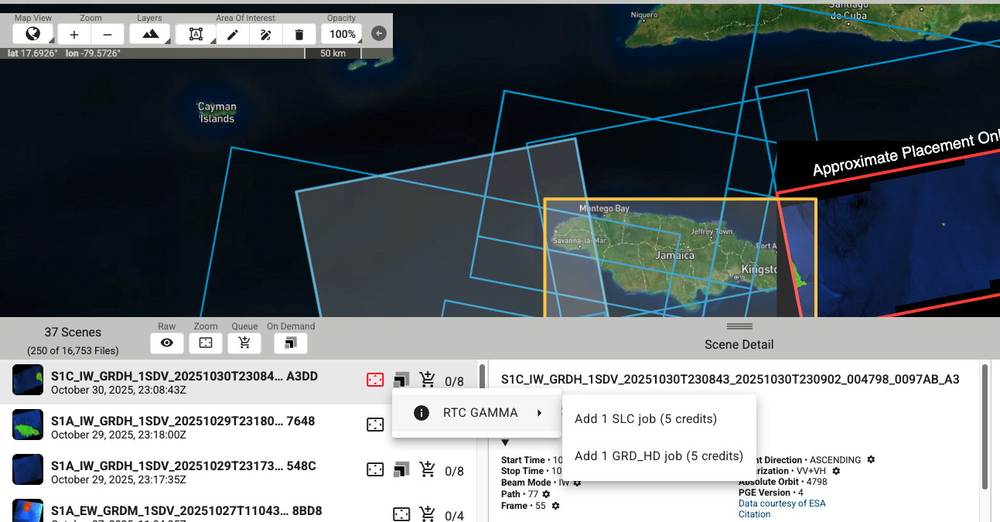
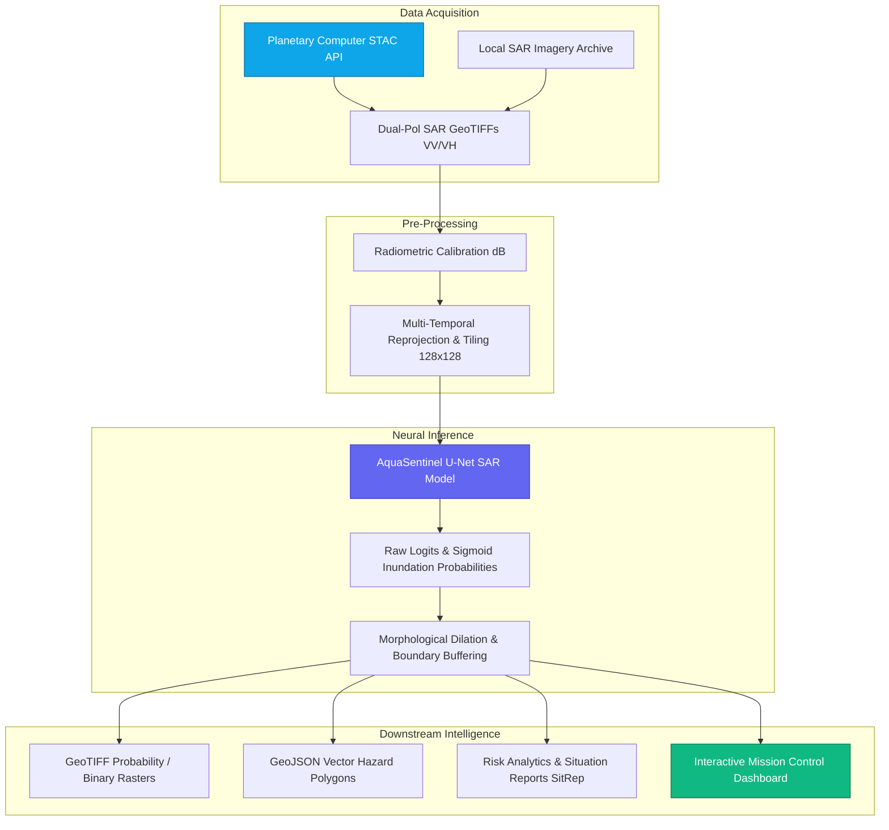
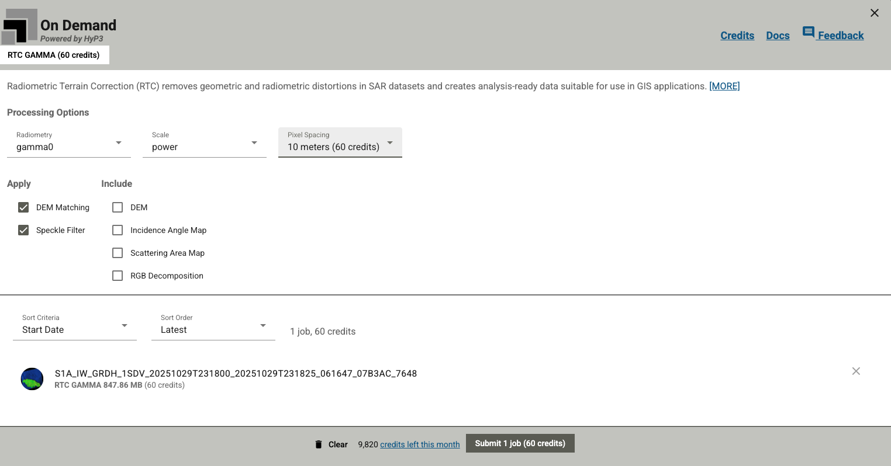

# 🛰️ AquaSentinel: Next-Gen Satellite SAR Flood Intelligence

[](https://www.python.org/)
[](https://pytorch.org/)
[](https://sentinels.copernicus.eu/)
[](https://streamlit.io/)
[](https://opensource.org/licenses/MIT)

> **Autonomous Synthetic Aperture Radar (SAR) flood inundation mapping, geospatial disaster analytics, and emergency mission control.**



---

## 🌊 Table of Contents

1. [Executive Overview](#-executive-overview)
2. [Key Capabilities](#-key-capabilities)
3. [Architecture & Workflow](#-architecture--workflow)
4. [Interactive Mission Control Dashboard](#-interactive-mission-control-dashboard)
5. [Disaster Risk & Impact Analytics](#-disaster-risk--impact-analytics)
6. [Installation & Setup](#-installation--setup)
7. [Running the Pipelines](#-running-the-pipelines)
8. [GeoJSON Vector Export for Emergency GIS](#-geojson-vector-export-for-emergency-gis)
9. [Pre-Trained Weights & Checkpoints](#-pre-trained-weights--checkpoints)
10. [Repository Structure](#-repository-structure)
11. [License](#-license)

---

## 🚀 Executive Overview

**AquaSentinel** is an end-to-end Earth Observation (EO) and artificial intelligence system designed for rapid humanitarian flood response. Flooding frequently occurs under dense monsoon cloud cover or torrential rain where optical satellite instruments (like Sentinel-2 or Landsat) are blinded. 

AquaSentinel harnesses **C-Band Synthetic Aperture Radar (SAR)** from Sentinel-1, which penetrates through thick clouds, heavy rain, and night darkness to capture surface water signatures via radar backscatter changes (VV and VH polarizations).

Powered by deep semantic segmentation (U-Net) and geospatial hazard intelligence, AquaSentinel converts raw radar scenes into:
- Calibrated flood extent masks.
- Physical impact metrics (inundated $km^2$, exposed population, affected agricultural land).
- Standardized Emergency Situation Reports (SitReps).
- GIS-ready GeoJSON hazard polygons for operational first responders.

---

## ✨ Key Capabilities

- 🛰️ **All-Weather Cloud-Penetrating SAR Detection**: Operates reliably day or night through active monsoon storms using radar backscatter change detection.
- ⚡ **Dual Ingestion Modes**: 
  - Direct cloud querying via **Microsoft Planetary Computer STAC API**.
  - Local multi-temporal SAR GeoTIFF processing.
- 🧠 **Pre-Trained Deep Learning Segmentation**: Integrated deep U-Net architecture (`aquasentinel_sar_model.ckpt`) trained on diverse international flood datasets.
- 📊 **Geospatial Impact & Risk Engine**: Calculates inundated surface area, automated disaster alert levels (Levels 1–4), and population/crop exposure statistics.
- 🗺️ **Mission Control UI Dashboard**: Interactive dark-mode web cockpit with multi-temporal imagery comparison, GIS map overlays, sector breakdowns, and automated SitRep downloads.
- 📐 **Vector Hazard Extraction**: Automated raster-to-polygon conversion filtering speckle noise and annotating hazard priorities for direct import into QGIS or ArcGIS.

---

## 🏗️ Architecture & Workflow





---

## 🖥️ Interactive Mission Control Dashboard

AquaSentinel includes a built-in mission control interface designed for emergency operations centers (EOC) and crisis managers.

```bash
# Launch AquaSentinel Mission Control Dashboard
python -m src.dashboard

# Or launch directly with Streamlit
streamlit run src/dashboard/app.py
```

### Dashboard Features:
- **Real-Time KPIs**: Immediate visibility over inundated area ($km^2$, hectares), basin flood percentage, exposed population count, and critical infrastructure risk.
- **Dynamic Emergency Status Badge**: Color-coded severity level (Advisory $\rightarrow$ Catastrophic) adhering to international civil protection protocols.
- **Interactive Geospatial Inundation Map**: Pan, zoom, and inspect water extents mapped over high-resolution dark satellite canvas.
- **Multi-Temporal Radar Visualizer**: Side-by-side inspection of pre-event VV, post-event VV, and AI predicted flood boundaries.
- **Vulnerability Breakdown**: Quantitative pie charts illustrating agricultural losses, urban displacement, and wetland absorption.
- **One-Click Situation Report Generator**: Download standardized Markdown SitReps and machine-readable JSON metrics for command briefings.

---

## 📈 Disaster Risk & Impact Analytics

The analytics engine (`src/analytics/flood_risk_analyzer.py`) programmatically evaluates flood severity and exposure:

```python
from src.analytics.flood_risk_analyzer import FloodRiskAnalyzer

# Initialize risk analyzer with regional parameters
analyzer = FloodRiskAnalyzer(default_pop_density_per_sq_km=220.0)

# Evaluate a flood prediction mask (20m resolution)
metrics = analyzer.analyze_mask(flood_mask, pixel_resolution_m=20.0, region_name="Sylhet Basin")

print(f"Total Flooded Area: {metrics.flooded_area_sq_km:.2f} km²")
print(f"Severity Classification: {metrics.severity_level.value}")
print(f"Estimated Affected Citizens: ~{metrics.estimated_affected_population:,}")

# Generate Disaster Situation Report
sitrep = analyzer.generate_situation_report(metrics)
```

### Severity Classifications:
| Level | Severity | Criteria | Standard Protocol |
| :--- | :--- | :--- | :--- |
| **Level 1** | Advisory | $< 10\text{ km}^2$ or $< 4\%$ | Maintain routine hydrologic observation |
| **Level 2** | Warning | $10 - 40\text{ km}^2$ or $4 - 12\%$ | Broadcast agricultural warnings; inspect retention levees |
| **Level 3** | Severe | $40 - 150\text{ km}^2$ or $12 - 25\%$ | Activate Emergency Operations Center; stage evacuation routes |
| **Level 4** | Catastrophic | $> 150\text{ km}^2$ or $> 25\%$ | Mobilize national disaster response & search & rescue |

---

## ⚙️ Installation & Setup

```bash
# Clone the repository
git clone https://github.com/navdeep-r/AquaSentinel.git
cd AquaSentinel

# Option A: Create Conda environment (recommended)
conda env create -f environment.yml
conda activate AquaSentinel

# Option B: Standard Python venv + pip
python -m venv venv
# On Windows:
.\venv\Scripts\activate
# On Linux/macOS:
source venv/bin/activate

pip install -r requirements.txt
```

---

## 🏃 Running the Pipelines

### 1. Run on Downloaded Local SAR Image Pairs

```bash
python src/run_flood_detection_downloaded_images.py \
    --pre_vv ./data/pre_event_vv.tif \
    --pre_vh ./data/pre_event_vh.tif \
    --post_vv ./data/post_event_vv.tif \
    --post_vh ./data/post_event_vh.tif \
    --model_path ./models/aquasentinel_sar_model.ckpt \
    --output_dir ./outputs \
    --output_name flood_predictions.tif \
    --buffer_size 8
```

### 2. Run with Microsoft Planetary Computer (On-The-Fly Query)

```bash
python src/run_flood_detection_planetary_computer.py \
    --region "Global" \
    --start_date "2023-08-01" \
    --end_date "2023-08-07" \
    --device_index 0 \
    --model_path ./models/aquasentinel_sar_model.ckpt \
    --output_dir ./outputs \
    --buffer_size 8
```

---

## 🗺️ GeoJSON Vector Export for Emergency GIS

Convert generated raster predictions directly into GIS-ready vector polygons:

```bash
python -m src.utils.vector_exporter \
    --input ./outputs/flood_predictions.tif \
    --output ./outputs/flood_hazard_polygons.geojson \
    --min_area_ha 0.5
```

The resulting GeoJSON includes polygon centroid coordinates, inundated surface area per cluster, and emergency response hazard priority tags.

---

## 📦 Pre-Trained Weights & Checkpoints

The repository includes pre-trained neural network weights ready for immediate execution:
- **Path**: `models/aquasentinel_sar_model.ckpt`
- **Architecture**: MobileNet-V2 Encoder + U-Net Segmentation Decoder.
- **Input Channels**: 2 (Dual polarization SAR: VV and VH).
- **Target Classes**: 2 (Background vs. Inundated Water Surface).

---

## 📁 Repository Structure

```text
AquaSentinel/
├── images/                             # Architectural diagrams & processing guides
├── models/
│   └── aquasentinel_sar_model.ckpt     # Pre-trained deep SAR segmentation weights
├── src/
│   ├── analytics/                      # Geospatial risk & damage impact engine
│   │   ├── __init__.py
│   │   └── flood_risk_analyzer.py      # Area, exposure, & SitRep calculator
│   ├── dashboard/                      # Interactive Mission Control Web Cockpit
│   │   ├── __init__.py
│   │   ├── __main__.py                 # CLI launcher: python -m src.dashboard
│   │   ├── app.py                      # Full-featured Streamlit UI
│   │   └── mock_data.py                # Realistic multi-temporal SAR generator
│   ├── data/
│   │   ├── country_boundaries/         # Natural Earth geopolitical shapefiles
│   │   └── region_polygons.py          # AOI spatial boundary query manager
│   ├── utils/
│   │   ├── flood_data_module.py        # PyTorch Lightning datamodule
│   │   ├── flood_dataset.py            # SAR dataset slicing & patching
│   │   ├── image_processing.py         # Radiometric dB scaling & patch stitching
│   │   ├── model.py                    # PyTorch U-Net architecture definition
│   │   └── vector_exporter.py          # Raster-to-GeoJSON hazard vectorizer
│   ├── merge.py                        # Multi-tile mosaic & compression utility
│   ├── run_flood_detection_downloaded_images.py  # Local file inference pipeline
│   └── run_flood_detection_planetary_computer.py # Cloud STAC inference pipeline
├── environment.yml                     # Conda dependency definition
├── pyproject.toml                      # Build tool & linter configuration
├── requirements.txt                    # Pinned Python package dependencies
└── README.md                           # Documentation & quick start guide
```

---

## 📜 License

This project is licensed under the **MIT License** – see the [LICENSE](LICENSE) file for details.
